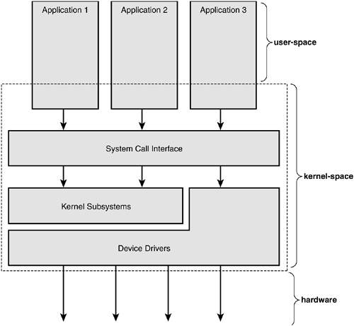
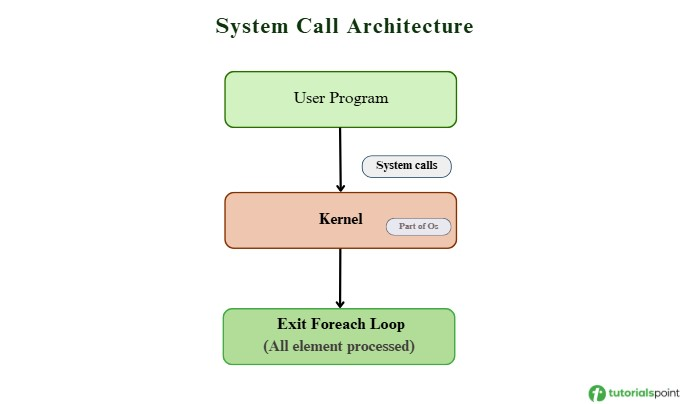
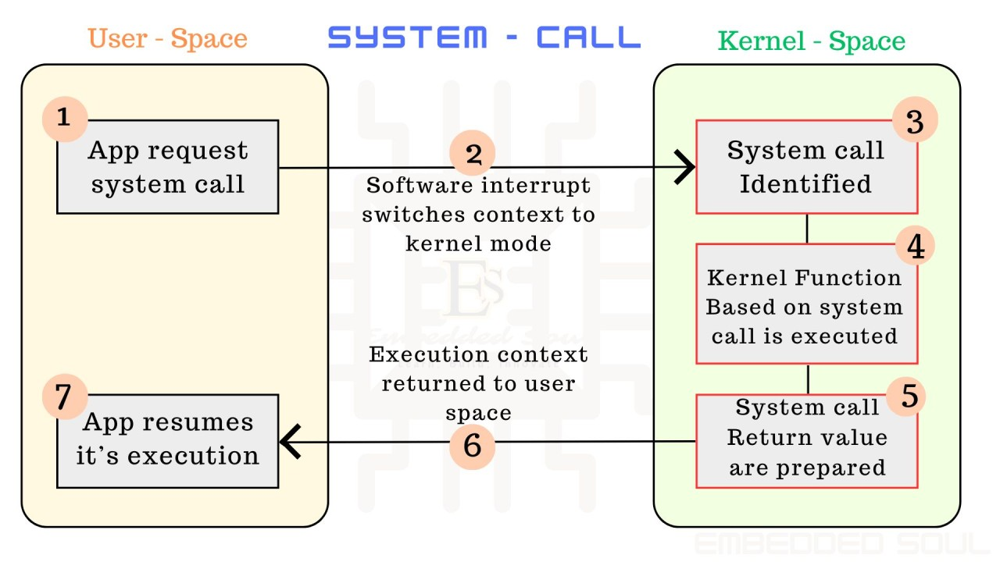

# 1. Overview of user-kernel communication interfaces

User programs run in **user space** with no direct access to hardware or kernel memory. Anything that needs the kernel (files, devices, network, process control) must cross the user/kernel boundary through an interface the kernel provides.

There is only one real gate: the **system call**. The other interfaces are different ways of *using* system calls:

- **System call**: a fixed, typed function for a general OS service.
- **ioctl**: one generic syscall that forwards driver-specific commands on an fd.
- **/proc**: kernel data exposed as virtual text files, read/written with normal file I/O.
- **Netlink**: a socket carrying structured messages in both directions, including kernel-initiated events.

## 1.1 System Call, IOCTL, proc file system, Netlink Socket - what each is for and when to choose it

| | System call | ioctl | /proc (and /sys) | Netlink |
|---|---|---|---|---|
| Purpose | Core OS services | Device/driver control | Inspect status, tune parameters | Configure subsystems, receive events |
| Data format | Typed C arguments | Binary struct, driver-defined | Text | Structured binary messages |
| Direction | User → kernel (request/reply) | User → kernel (request/reply) | User reads/writes on demand | Both ways, kernel can push |
| Needs | Nothing | An fd (often a device file) | A file path | A netlink socket |
| Typical users | Every program | `tcsetattr`, V4L2, GPIO, KVM | `ps`, `top`, `free`, `sysctl` | `ip` (iproute2), udev |

**When to choose:**
- **System call**: a general service every program needs. You never add one for a single driver; new syscalls are rare and reviewed heavily.
- **ioctl**: you control a specific device through its fd and need fast, structured commands (set mode, get config, start DMA).
- **/proc or /sys**: simple values that humans and shell scripts should read or change with `cat`/`echo`. Use `/sys` for device/driver attributes, `/proc` for processes and kernel-wide info.
- **Netlink**: the kernel must *notify* user space of events, or you exchange complex, extensible messages (networking config, hotplug).

Rule of thumb: *one value, human-readable* → sysfs/procfs; *command to a device* → ioctl; *events or rich two-way messages* → netlink.

# 2. System call

A **system call** is how a user-mode process asks the kernel to do something on its behalf: open a file, read/write, create a process, get more memory. It is the only controlled entry point into the kernel.

The **system call interface** is the set of all system calls the kernel provides, plus the convention for calling them (syscall number, how arguments are passed, how results and errors are returned). It is the boundary between user space and kernel space.

***Core ideas***

1. **Protection, enforced by hardware.** The CPU has two privilege levels: user mode and kernel mode. In user mode, privileged instructions and kernel memory are blocked. So only the kernel can touch hardware or sensitive data.
2. **Controlled mode switch.** A process cannot jump into the kernel freely. It executes a special trap instruction (`syscall` on x86-64, `svc` on ARM), which switches the CPU to kernel mode and jumps to a fixed entry point chosen by the kernel.
3. **The kernel validates first.** It checks the syscall number, the arguments, and the process's permissions. Data behind user pointers is copied safely (`copy_from_user` / `copy_to_user`), never trusted directly.
4. **Runs in process context.** The same process (same PID) runs kernel code on its own kernel stack. A syscall is a *mode switch*, not a *context switch*.
5. **Can block.** A syscall like `read()` on an empty pipe puts the process to sleep until data arrives; the scheduler runs other processes meanwhile. A signal may interrupt it (`EINTR`).
6. **Library function ≠ system call.** `printf()` and `malloc()` are library functions; they may make zero, one, or many syscalls. (`man 2` = syscalls, `man 3` = library functions.)

***Flow***

1. The program calls a C library wrapper, e.g. `read()`.
2. The wrapper puts the syscall number and arguments into registers.
3. It executes the trap instruction; the CPU enters kernel mode.
4. The kernel saves registers, looks up the handler in the **system call table**, and runs it.
5. The kernel puts the result in a register and returns to user mode. On error it returns a negative error code.
6. The wrapper turns an error into `errno` and returns `-1`; otherwise it returns the result.

***Key takeaways***

- Syscalls are much slower than normal function calls (mode switch, saving state, checks), so batch work into fewer calls (that is why stdio buffers).
- Linux keeps the syscall ABI stable, so old binaries keep working on new kernels. Syscall numbers differ between CPU architectures.
- `strace ./prog` shows every syscall a program makes.

# 3. ioctl interface

**ioctl** (input/output control) is a general-purpose system call for sending device-specific control commands through a file descriptor: `ioctl(fd, request, arg)`.

***Core ideas***

1. **Problem.** In UNIX "everything is a file", but `read()`/`write()` only move bytes. Devices also need operations like setting a serial port's baud rate or reading the terminal size. Adding one syscall per such operation would bloat the kernel.
2. **Solution.** One syscall acts as a common gate. The meaning of `request` and `arg` is defined by each driver; the kernel just forwards them.
3. **Mechanism.** The kernel uses the fd to find the driver and calls the driver's ioctl handler (registered in `file_operations`), which is usually a `switch (request)`. Pointer data is copied with `copy_from_user` / `copy_to_user`.
4. **Request codes** are built with the `_IO`, `_IOR`, `_IOW`, `_IOWR` macros, encoding a driver ID, command number, data direction, and data size, to avoid collisions.

## Key takeaways

- There is no common standard for commands; read the driver's header or docs.
- It is hard to type-check and audit, so newer kernel interfaces often prefer sysfs or netlink, though ioctl is still widely used.

# 4. proc file system interface

**/proc** is a virtual (pseudo) file system mounted at `/proc`. It exposes kernel and process information as files you can read (and sometimes write) with normal file operations or tools like `cat` and `echo`.

## Core ideas

1. **Problem.** Programs need kernel information (memory usage, open files of a process) and sometimes need to tune kernel parameters. One syscall per item would not scale, so the kernel exposes them as files.
2. **Mechanism.** Nothing is stored on disk. When you `read()` a /proc file, the kernel calls a handler that formats the current data as text. Writing to some files calls a handler that changes a kernel parameter.
3. **Main layout:**

| Path | Content |
|---|---|
| `/proc/<PID>/` | Info about one process: `status`, `cmdline`, `maps`, `fd/`, `exe`, `cwd` |
| `/proc/self` | Link to the current process's own directory |
| `/proc/cpuinfo`, `/proc/meminfo`, ... | System-wide info |
| `/proc/sys/` | Tunable kernel parameters (read/write) |

4. **Kernel side.** A module can create its own /proc entry with `proc_create()`.

**Key takeaways**

- Data is text: easy for humans and shell tools, but programs must parse it, and the format may change.
- Content is a snapshot at read time.
- /proc became cluttered over time, so **sysfs** (`/sys`) was added to represent devices and drivers in a more organized way.

# 5. Netlink socket interface

**Netlink** is a two-way message channel between user space and the kernel, using the socket API with the `AF_NETLINK` address family. Data is exchanged as structured binary messages.

***Core ideas***

1. **Problem.** With ioctl and /proc, only user space can ask; the kernel cannot push notifications. Programs would have to poll to detect events like a cable plugged in or an IP address change.
2. **Solution.** Use sockets. This gives asynchronous send/receive, queuing, `poll()`/`select()`/`epoll()` support, and multicast groups so the kernel can broadcast events.
3. **Mechanism.**
   - Create a socket: `socket(AF_NETLINK, SOCK_RAW, NETLINK_ROUTE)`. The protocol selects the kernel subsystem (e.g. `NETLINK_ROUTE` for networking).
   - `bind()` with a `struct sockaddr_nl` to set your ID and the multicast groups to join.
   - Each message starts with a `struct nlmsghdr` header (length, type, flags, sequence number, sender ID), followed by the payload.
4. **Two usage patterns:** request/response (e.g. add an IP address) and event notifications (subscribe to a group, and the kernel sends messages when something happens).

***Key takeaways***

- Modern network tools like `ip` (iproute2) use netlink, replacing the old ioctl-based `ifconfig`/`route`. udev also uses it for device hotplug events.
- Structured binary data: more precise than /proc text, but must be parsed by format.
- No device file needed, and communication works in both directions.
- Messages can be dropped if the receive queue overflows, so programs must handle that.
